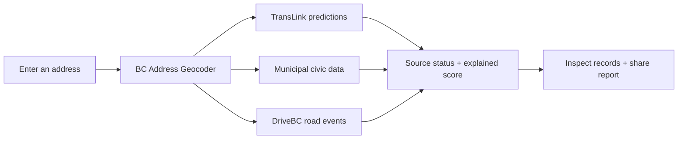

<div align="center">

# 🏙️ MetroPulse

### Know the block before you sign.

<p>
  <a href="https://github.com/koonergurjot/MetroPulse/actions/workflows/ci.yml"></a>
  <a href="LICENSE"></a>
  <a href="CONTRIBUTING.md"></a>
  <a href="https://github.com/koonergurjot/MetroPulse/issues?q=is%3Aissue+is%3Aopen+label%3A%22good+first+issue%22"></a>
  
</p>

The listing shows the kitchen. **MetroPulse helps you investigate the neighborhood.**

A map-first Lower Mainland explorer: a night-mode 3D map, price pins with deal signals, walk rings, planned SkyTrain, and a sourced block report for any address or pin.

[Explore the report](#-try-it-locally) · [Check coverage](#-where-does-it-work) · [**Contribute**](#-contribute) · [See the roadmap](docs/IMPLEMENTATION_PLAN.md) · [Read the blueprint](docs/BLUEPRINT.md)

</div>

---

## 🗺️ The map

- **Zoom-driven detail:** region heat and clusters → price pins → 3D buildings with transit stops and a block report at street level.
- **Deal signals:** each listing is compared with the median $/sqft of similar listings (same kind, type, municipality). It is a "worth a look" indicator, not an appraisal.
- **Block report:** click a listing, search an address, or use **Drop pin** to see permits, 311, rental standards, road events and transit around a point, with walk rings and source status.
- **Basemap:** custom dark style over OpenFreeMap vector tiles (MapLibre GL JS). Production upgrade path: self-hosted Protomaps PMTiles on Cloudflare R2.

### About listings (read this)

Listings are **demo data** generated by `src/server/listings/demoProvider.ts`. MetroPulse deliberately does **not** scrape listing sites: Canadian courts have enforced site terms and awarded copyright damages against scrapers of listings and photos, and MLS® data is only licensed through CREA DDF® or board IDX feeds sponsored by a brokerage. To show real listings, implement `ListingProvider` (`src/server/listings/types.ts`) for a licensed feed and return it from `getProvider()`. The UI needs no changes.

New endpoints: `GET /api/listings?west&south&east&north[&kind&types&minPrice&maxPrice&minBeds&sort&limit]`, `GET /api/stops?west&south&east&north`, and `GET /api/art/<id>.svg` (demo illustrations). `GET /api/pulse` also accepts a `locality` hint alongside `lat`/`lng`.

## 🔎 What would you want to know before moving in?

<details open>
<summary><strong>🚌 “What’s transit doing near this address?”</strong></summary>

Nearby stops, upcoming departure predictions, median predicted delay, and relevant service alerts. These describe current predictions, not months of measured reliability. Historical analysis is on the roadmap.

</details>

<details>
<summary><strong>🏗️ “What’s going on next door?”</strong></summary>

Inspect returned building permits, service requests, and active DriveBC road events, with dates and distances where available. A permit is a clue to investigate, not proof that construction is active. Civic status/date filtering and completeness checks still need work.

</details>

<details>
<summary><strong>🏠 “Are there rental building issues nearby?”</strong></summary>

Vancouver’s rental-standards records provide another question to ask before signing. Expand records in the report to inspect the available details. Nearby issues do not establish a violation at the specific building you searched.

</details>

<details>
<summary><strong>🧭 “Can I trust the score?”</strong></summary>

Every component explains its contribution. Missing sources lose their weight; the composite is withheld unless more than half the original weight is available. Disruption requires both service-request and road-event data.

The Pulse Score is an experimental summary of available signals, not a guarantee about an address. Start with the evidence beneath it.

</details>

## 🚀 Try it locally

Use **Node 22.6+** for the TypeScript scripts. A current Node 22 release is recommended.

```bash
npm ci
npm test
npm run typecheck
npm run build
```

In one terminal, start the API:

```bash
TRANSLINK_API_KEY=your-key npm run dev:api
```

In another, start the app:

```bash
npm run dev
```

Open [localhost:3000](http://localhost:3000), enter an address, and expand the nearby records. The address report is the default screen. Shared reports use `/report/<address-slug>`.

> **Transit setup:** the included ten-stop sample uses placeholder IDs. Generate the real stop index below to match live predictions. Without a TransLink key, transit predictions are unavailable; the rest of the report can still show available data.

<details>
<summary><strong>Try the API directly</strong></summary>

```bash
curl 'http://localhost:8787/api/pulse?address=555+W+Hastings+St+Vancouver'
curl 'http://localhost:8787/api/pulse?lat=49.2827&lng=-123.1207&radius=600'
curl 'http://localhost:8787/api/health'
```

Each source reports `ok`, `stale`, `error`, or `skipped`. Civic/transit failures can produce a partial `200` response with a withheld score. Invalid input and address-resolution failures have separate error responses.

Coordinates currently lack municipality resolution, so civic categories are skipped for coordinate-only queries. Use a street address for the fullest report.

</details>

## 📍 Where does it work?

These are implemented adapters, **not a live availability guarantee**. Upstream endpoints and fields must be verified before launch.

| Location | Transit¹ | DriveBC roads | 311 requests | Permits | Rental standards |
| --- | --- | --- | --- | --- | --- |
| Vancouver | ✓ | ✓ | ✓ | ✓ | ✓ |
| Surrey | ✓ | ✓ | — | ✓ | — |
| Burnaby | ✓ | ✓ | — | ✓ | — |
| Other Metro Vancouver locations | ✓ | ✓ | — | — | — |

¹ Transit requires a working API key and real stop index. DriveBC coverage does not include every local road closure. “—” means no adapter yet. Missing data appears as unavailable, rather than a reassuring zero.

## ⚙️ One address → one report



| Want to explore… | Start here |
| --- | --- |
| The address report | [`src/components/LiveDemo.tsx`](src/components/LiveDemo.tsx) |
| How sources are combined | [`src/server/pulse.ts`](src/server/pulse.ts) |
| Score calculations | [`src/server/score.ts`](src/server/score.ts) |
| The transit archive | [`scripts/snapshot.ts`](scripts/snapshot.ts) |
| What happens next | [Implementation plan](docs/IMPLEMENTATION_PLAN.md) |

## 🛠️ Open the toolbox

<details>
<summary><strong>Build the real transit stop index</strong></summary>

```bash
curl -fL https://gtfs-static.translink.ca/gtfs/google_transit.zip -o /tmp/gtfs.zip
unzip -o -d /tmp/gtfs /tmp/gtfs.zip stops.txt
npm run build:stops /tmp/gtfs/stops.txt data/stops.csv
STOP_INDEX_PATH=data/stops.csv TRANSLINK_API_KEY=your-key npm run dev:api
```

Refresh the index when static GTFS changes. Cloudflare Workers need an HTTPS URL to the generated CSV; local file paths only work with the Node API.

</details>

<details>
<summary><strong>Configuration</strong></summary>

| Variable | Purpose |
| --- | --- |
| `TRANSLINK_API_KEY` | Required for transit predictions and alerts |
| `BC_GEOCODER_API_KEY` | Optional DataBC key for higher rate limits |
| `STOP_INDEX_PATH` | Local CSV or hosted HTTPS URL for real stop IDs |
| `DEFAULT_RADIUS_M` / `MAX_RADIUS_M` | Search radius bounds; defaults 800 / 2000 |
| `FANOUT_BUDGET_MS` | Upstream fan-out budget; default 6000 ms |
| `SUPABASE_URL` / `SUPABASE_SERVICE_KEY` | Durable transit archive storage |

Upstream URLs and dataset IDs are overridable in [`config.ts`](src/server/config.ts). Environment variables must be supplied to the process; the scripts do not automatically load `.env` files. Never expose the Supabase service key in frontend code.

</details>

<details>
<summary><strong>Check sources before launch</strong></summary>

```bash
npm run verify:sources
```

This currently checks reachability and nonempty responses. It does not validate field mappings, count completeness, or score accuracy. The test suite uses fixtures and does not establish live provider availability.

</details>

<details>
<summary><strong>Deploy to Cloudflare Workers</strong></summary>

Set `STOP_INDEX_PATH` in [`wrangler.jsonc`](wrangler.jsonc) to a hosted real stop index and configure the API secret:

```bash
npx wrangler secret put TRANSLINK_API_KEY
npm run deploy:dry
npm run deploy
```

For Git-integrated deployments, use `npm run build` as the build command and `npx wrangler deploy` as the deploy command. The Worker serves the Vite assets and API together.

</details>

<details>
<summary><strong>Collect transit history</strong></summary>

[`snapshot.yml`](.github/workflows/snapshot.yml) polls every five minutes on GitHub Actions using Node 22. Configure repository secrets `TRANSLINK_API_KEY`, `SUPABASE_URL`, and `SUPABASE_SERVICE_KEY`; scheduled runs fail if durable storage is missing.

Local snapshot runs can still use JSONL for development:

```bash
TRANSLINK_API_KEY=your-key node --experimental-strip-types scripts/snapshot.ts
```

Before production collection: finish archive identity, database access protection, rollups, and gap monitoring in the [plan](docs/IMPLEMENTATION_PLAN.md). GitHub cron is best-effort and cannot provide a continuous 30-second archive.

</details>

## 🌱 What’s next?

- [x] Address search as the default screen
- [x] Explained scores and source attribution
- [x] Inspectable civic records and explicit unavailable states
- [x] Transit-choice and half-coverage scoring regression fixes
- [ ] Validated provider schemas, status/date filters, and complete counts
- [ ] Automated real stop-index refresh and municipality lookup for coordinates
- [ ] Reliable historical aggregates and collection monitoring
- [ ] Filterable activity map
- [ ] Saved addresses and commute-watch digests

Follow the [implementation plan](docs/IMPLEMENTATION_PLAN.md) for dependencies and acceptance criteria. The legacy presentation tabs remain available as project background and still need their older outing-focused content updated.

## 🙋 Contribute

MetroPulse is early, open source, and built to be extended by people who know their own city. You do not need a TransLink key to contribute: the test suite runs offline on fixtures.

```bash
git clone https://github.com/koonergurjot/MetroPulse.git && cd MetroPulse
npm ci && npm test      # Node 22.6+, no API keys needed
```

**Pick something that fits you:**

| If you want to… | Start here |
| --- | --- |
| Add your city (Richmond, New Westminster, Coquitlam…) | [Adding a municipality](docs/ADDING_A_MUNICIPALITY.md): one adapter plus one registry entry |
| Make the data more trustworthy | Add fixture tests for the Vancouver adapter (see `drivebc.test.ts` as a template), or make `verify:sources` check field names |
| Make the score more honest | Filter permits and 311 requests by status and date (the score says “recent” and “open”; the queries do not filter yet) |
| Work on the map | Show raw civic records on the map; add a municipality lookup for coordinate-only queries |
| Bring real listings | Implement a licensed `ListingProvider` (no scraping, see the note above) |

Read [CONTRIBUTING.md](CONTRIBUTING.md) for the ground rules (explainable scores, honest missing-data states, attribution) and look for [`good first issue`](https://github.com/koonergurjot/MetroPulse/issues?q=is%3Aissue+is%3Aopen+label%3A%22good+first+issue%22). Participation is covered by the [Code of Conduct](CODE_OF_CONDUCT.md); security reports go through [SECURITY.md](SECURITY.md).

## 🤝 Built on public data

The code is [MIT licensed](LICENSE); the data it displays is not part of that licence. Reports display provider attribution. Most civic sources use open-government licences; TransLink has its own Open API Terms of Use. Review applicable terms before commercial use.

**A better-informed question before signing is already a better start.**
